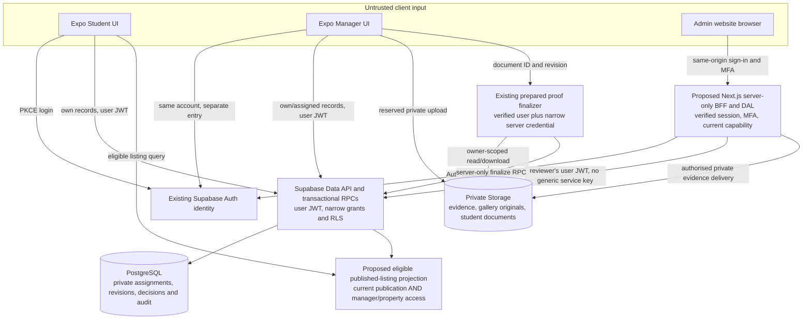

# H1.5 — Backend integration architecture and security plan

Prepared 23 October 2026. **Planning only. Nothing in this package authorises implementation, deployment, role assignment, resource creation, readiness activation or a change to production's HTTP 403 boundary.**

**Later local implementation:** [H1.5B1](../phase-h1-5b1-manager-review-security.md) adds a separate forward security migration, preserving the H1.3 hash below. The following inventory is the H1.5 planning baseline; review the B1 report for locally implemented MFA/review/notes contracts and both exact deployment fingerprints. Neither migration is deployed, and no broader roadmap item is implicitly approved.

## Documents and decisions

| Document | Deliverables |
| --- | --- |
| [Contract inventory](contracts.md) | Repository evidence, historical remote inventory, exact H1.3 signatures/ACLs, proposed entities/endpoints, models and environment names |
| [Identity and admin security](identity-and-admin.md) | Unified identity, permission matrix, first-administrator procedure, MFA, Next.js SSR/BFF, revocation and threat controls |
| [Integration workflows](workflows.md) | Manager and property request/response sequences, publication model, RLS/storage/audit rules, mobile adapter boundaries |
| [Testing, deployment and roadmap](deployment-and-roadmap.md) | Offline/hosted evidence, blocked staging, backups/recovery, approval-gated rollout, reviewable phases, risks and decisions requiring approval |

Read this index first, then contracts, identity, workflows and deployment. **E** denotes implementation present in the repository; **H** denotes a historical remote observation; **P** denotes a proposal; **B** denotes an unresolved verification/deployment gate. E never means that local SQL is deployed or that mocked service tests prove hosted behaviour.

## Current truth

| Area | Verified repository state | Boundary |
| --- | --- | --- |
| Mobile Auth | Supabase JS **2.118.0**; PKCE, email confirmation, recovery, validated restoration, secure native session storage | Auth calls are implemented; this phase did not log in, inspect users or revalidate hosted settings |
| Student/Manager entry | Separate Login/Register and ManagerLogin/ManagerRegister routes; shared account controller; intent is session navigation preference | One identity can use Student Home and later apply for manager access; no role comes from route choice |
| Manager verification | One additive local migration, version-1 state DTO, seven public RPCs, private proof bucket policies and one finalizer Edge Function | **Not deployed**, not hosted-security-tested; readiness defaults false |
| Manager Workspace | Guard checks fresh verification state; local reducer/gallery/application fixtures remain inside the workspace | Real account access does not make portfolio records persistent or authoritative |
| Admin website | Separate **Next.js 16.4.2 / React 19.2.3 / TypeScript 6.0.3** app; no Supabase dependency/client installed | Development-only synthetic session providers; production admin routes return 403; disabled sign-in |
| H1.4.1 | Three approval confirmations, stronger reason rules, explicit modal, in-memory decision metadata and notes | No server checklist/notes/MFA contract yet |
| H1.4.2 | Six property scenarios, galleries, rooms/claims/amenities, separate review and manager-access safeguards | No property database, ownership grants, moderation RPC or publication service |
| Student applications/documents/messages/favourites | Existing local/session providers and local private document staging | Do not reinterpret these as remote applications, uploads, bookings, deliveries or persistent data |
| Staging | Ignored isolated CLI workspace prepared; capacity trial stopped before a Supabase stack existed | Docker registration recovery remains unresolved; two important Free cloud projects must not be repurposed |

The user reports all six admin sections manually reviewed. This plan does not substitute that visual review for authentication, authorization or hosted integration evidence.

## Recommended architecture — proposed

Use the existing Supabase Auth project as the identity authority, database/RLS and narrow transactional functions as the domain authority, a same-origin Next.js server boundary for administrative requests, and separate typed mobile adapters. Keep privileged evidence processing confined to purpose-specific trusted workers. Do not install a general service-role CRUD client in the admin browser or route handlers.

The diagram is the target architecture, not an account of deployed resources. The private Storage layer and application functions exist only as local H1.3 artifacts today. Property, student persistence and admin BFF paths are proposed.

## Decisions that drive the implementation

1. **Capabilities, not mutually exclusive account roles.** A confirmed account starts with ordinary student capabilities. Manager access, property assignments and administrative/reviewer capabilities are additional current server-controlled records. Suspension of manager access does not by itself revoke ordinary Student Home access.
2. **No administrative integration on unmodified H1.3.** Direct authenticated invocation of the old review RPC would bypass H1.4.1's checklist/minimum reason and any web-only MFA check. A separately reviewed forward security extension must close every legacy entry point before real review UI is enabled.
3. **Separate verification and publication.** Manager approval establishes platform manager eligibility; it is not legal proof of authority over every property. Require a trusted property-specific assignment and separate moderation of an immutable submitted revision.
4. **Eligibility at read time.** Published status alone cannot expose a listing. Every student listing, room, media and application-target read must recheck current responsible-manager and property-assignment eligibility. Revocation is enforced in the database, not by delayed client polling or cache invalidation.
5. **Private-first media.** Keep verification/student/authority evidence and gallery originals in distinct private buckets. Initially serve approved gallery derivatives through authenticated, eligibility-checked delivery; do not assume public bucket URLs can be instantly revoked.
6. **No silent prototype promotion.** Synthetic admin IDs/media/history and mobile local portfolio/application records are never automatically imported. Real adapters use separately discriminated DTOs, authoritative stable IDs and safe error paths.
7. **Staging and recovery are gates.** Offline SQL tests are valuable but cannot clear hosted Auth, Storage, gateway, concurrency, MFA or recovery requirements. No available isolated stack means remote integration release remains blocked, not that production becomes a test environment.

These are recommendations requiring the approvals listed in the roadmap, not permissions granted by this planning phase.

## Evidence inspected

- `App.tsx`; `src/auth/{account,client,controller,sessionStorage,secureStorage,secureStorage.web}.ts`; `src/state/AuthContext.tsx`; `src/navigation/types.ts`; `src/screens/AccountScreens.tsx`.
- `src/verification/{domain,api,controller,useManagerVerification,evidence}`; `src/components/ManagerVerificationForm.tsx`; manager/student local providers, room/property DTOs and image/document adapters.
- `supabase/migrations/20261021135040_manager_verification.sql`, `supabase/config.toml`, `supabase/functions/manager-verification-finalize/{index,handler}.ts`, Deno configuration/lock, preflight SQL, offline/hosted/local test runners and target guards.
- H1.3 preflight, readiness/security follow-up, isolated configuration and failed capacity-trial reports; Docker recovery report only, without accessing the backup.
- Admin proxy/layout/page guards, Next configuration, disconnected future adapter, session providers, H1.4.1 and H1.4.2 contracts/components, scripts, tests and both CI workflows. Installed Next authentication/cookies documentation was checked; `cookies()` is async and a shared layout is not sufficient authorization.

Repository source takes precedence over historical reports. The current migration hash is **`6317d6fbc72b819b09d30523029c5f815b5ec6c409785c24ece29aecd89cf8ab`**. The older preflight hash beginning `4f920f` predates readiness hardening and is not a deployable approval target.

## Verification performed for this planning phase

- Existing in-memory PostgreSQL security runner: **79/79 passed**, PGlite 0.5.11 / PostgreSQL **18.6**, synthetic Auth/Storage catalogs only. This is not hosted PostgreSQL 17.11 or Supabase HTTP evidence.
- Existing admin unit/render/security tests: **77/77 passed**.
- Existing local Auth/journey/storage/verification/hosted-target/local-isolation/Metro guard tests: **191/191 passed**.
- Documentation links/contract references, whitespace and preservation checks were performed. All **271** starting Git-visible files, the Git index and root cloud `.env.local` remain unchanged; only this five-file documentation package was added.
- No app code changed, so builds, typecheck, lint, browser/device tests and hosted tests were not rerun. H1.4.2's 55 preview and 12 production browser checks remain explicitly historical results in its report, not fresh H1.5 execution claims.

No SQL was executed against a live/local service, no Docker command ran, no cloud resource or credential changed, and no Supabase project-management tool was used. The SQL check used only a new in-memory WASM database. No new dependencies, implementation files, migration files or scripts were created.

## Documentation basis and assumptions

Current official Supabase documentation and changelog were checked on 23 October 2026. The markdown changelog endpoint could not be consumed by the browser tool; the official HTML changelog and relevant linked notices were read instead. In particular, future migrations must explicitly declare grants as well as RLS; Supabase announces default-exposure changes for existing projects on 30 October 2026. No project setting was changed. [Official exposure notice](https://supabase.com/changelog/45329-breaking-change-tables-not-exposed-to-data-and-graphql-api-automatically).

Assumptions to validate before implementation: production hosting origin and operational owners are undecided; no trusted app administrator/reviewer is assigned; no new staging slot or paid budget exists; existing Auth accounts must not be used as QA fixtures; retention/MFA/revocation targets below are proposals. No present-day hosted schema/account/bucket status is asserted from this task's public documentation lookup.
